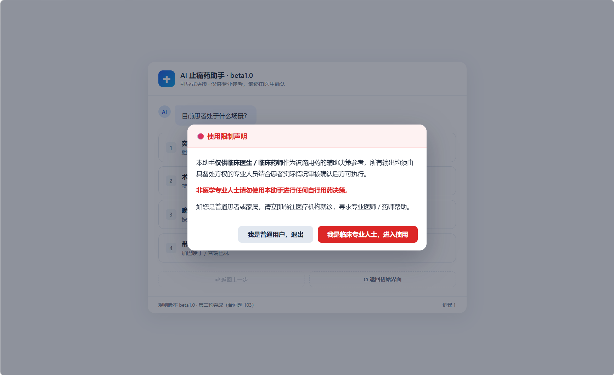
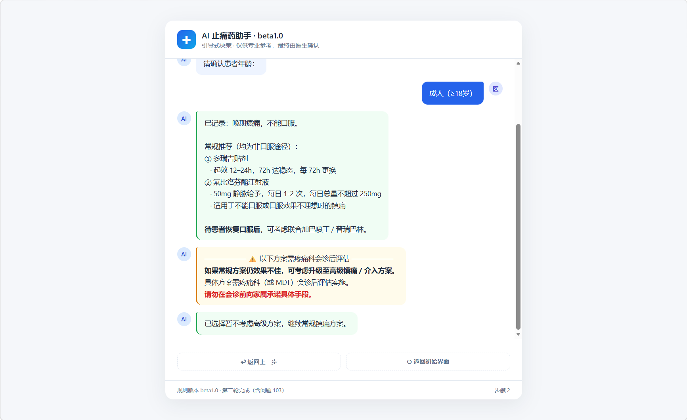

# AI 止痛药助手

> 🚨 **WARNING**：本助手是一个可嵌入临床工作流的 AI 辅助决策工具，**仅供具备处方权的临床专业人士使用**。非医学专业人士请勿使用本工具进行自我诊断或自行开具药物；如有疼痛问题，请前往正规医疗机构就诊。作者不承担因使用本工具产生的任何责任。

一个面向临床一线的引导式镇痛用药决策助手。单文件 HTML，打开即用。

**在线体验**：https://missormosia.github.io/analgesic-decision-support/

## 📸 界面预览 / Preview

1. **合规与安全拦截（强制警告）**：打开即触发，防止非专业人士误用，这是医疗产品的底线。

2. **临床决策输出与预警**：针对晚期癌痛+不能口服的患者，系统给出的阶梯推荐及高危风险提示。

> 📝 **当前状态**：最终输出内容（用药方针）的措辞仍在进一步修订中，beta1.0 规则框架已冻结。

**🇬🇧 [English version at the end ↓](#-english-version)**
---

## 项目背景（简版）

作者为三甲医院外科医生（5 年）。疼痛管理是日常工作的重要一环：术后疼痛、晚期癌痛、胆绞痛、急诊常见的泌尿系痉挛痛、以及免疫力低下患者的带状疱疹，都需要快速、规范地做出镇痛决策。

工作中观察到两个痛点：

1. **用药粗糙**：很多医生对止痛药的使用停留在"常见几种来回换，不行就喊疼痛科会诊"，但夜班等场景下往往没有条件立即获得会诊意见；
2. **知识零散**：止痛药的禁忌筛查（年龄分层、消化道基础病、肾功能分层）散落在各药说明书里，没有一个工具能把它们串成一条强制执行的流程。

最初为求职做过一份止痛药决策树文档（分类表格 + 术后/癌痛阶梯路径），后来以此作为蓝本，通过 AI 辅助编程（vibe coding）将它迭代为可交互的决策助手，并在持续测试中修复了 100+ 个临床安全、代码与交互问题。

详细背景见 [docs/项目背景.md](docs/项目背景.md)。

---

## 为什么这样设计（医学依据）

四条医学原则决定了整个助手的骨架：

| 医学事实 | 对应设计 |
| :--- | :--- |
| 多数止痛药小儿不能用或严格区分年龄段甚至剂型（如对乙酰氨基酚片剂不推荐 6 岁以下，应选滴剂/混悬液）——说明书可查 | 小儿精确年龄输入 + 2/6/12 岁阈值判断 + **小儿白名单**（仅限右旋布洛芬、对乙酰氨基酚、曲马多>12 岁、间苯三酚>2 岁） |
| 非选择性 NSAIDs 损伤胃肠道黏膜，胃十二指肠溃疡为说明书禁忌，IBD 患者可能加重病情 | NSAIDs 禁忌筛查**弹窗门控**，合并症路径自动从阶梯中移除 NSAIDs |
| 多数止痛药经肾脏代谢 / 具肾毒性，肾功能不全需减量甚至禁用 | 全局必经**肾功能筛查**（正常/异常/未查三态 + 五层分层 + Scr/eGFR 手动计算，儿童用 Schwartz 公式） |
| 小儿叠加意外情况、中度以上肾损伤是典型高危场景——不鼓励医生在高危场景下自行决定用药，这是医疗安全与规避法律风险的最优解 | **三级安全闸门**：红字警示 → 建议会诊（可继续）→ **强制会诊**（不提供任何药物推荐） |

最后一条尤为重要：AI 助手可以提供建议，但如果医生因为助手的建议而轻敌大意、忽略了向专科寻求医疗资源，这种思路是致命的。因此高危场景下本助手的设计选择是"**宁可不提供建议，也要把医生推向会诊**"。

## 交互设计哲学

作者本人就是目标用户，而临床医生非常繁忙：

- **低认知负荷**：所有交互都是点选式弹窗/按钮，不耗脑容量。一个用起来复杂难用的助手，忙碌的医生会直接弃用；
- **防敷衍设计**：正因为繁忙，如果强制会诊的理由填写没有审计校验，医生有充分理由胡写乱写——所以拒绝会诊必须填写经校验的临床理由（≥5 个汉字、去重检测），且全程留痕于审计日志；
- **可回退**：任何一步都可以"返回上一步"，回到上一个可交互屏幕重新选择。

## 关键决策（工程向）

1. **历史栈只记录"可交互屏幕"**（问题 94）：弹窗（肾功能/NSAIDs 筛查等）是暂态模态动作，不进历史栈；"返回上一步"语义 = 回到上一个主聊天区可交互屏幕。放弃"弹窗逐层回退"方案，因为它会让 capture 时机和栈深度失控。
2. **终点屏也必须入栈**：否则返回时会多弹一层、把用户送回两级之前。为此定义了统一的 `finishScreen()` 收尾约定。
3. **分支判断一律用 id，禁用子串匹配**（问题 91）："不能口服"包含"能口服"曾导致癌痛路径输出口服方案——所有选项改为 `opt.id` 判断。
4. **高危拦截前置**（问题 103）：小儿 + 任意肾功能不全（含轻度）在肾功能分层确认后立即强制会诊，不进入场景推荐，避免"先建议、后强制"的语义重复。
5. **多瑞吉前置阿片耐受筛查**（问题 72）：芬太尼透皮贴禁用于阿片未耐受患者，推荐前必须先确认耐受状态。

## 问题类型与经典案例

迭代全程累计记录 **102 条问题**（编号 1–103，其中 102 号为空号，另含 2 项作废、1 项确认无需修改），分六大类：临床决策与逻辑一致性（13）、临床安全与风险规避（43）、审计与依从性管理（6）、交互复杂度与认知负荷（20）、工程实现（12）、视觉、文案与其他（8）。完整清单见 [docs/问题日志.md](docs/问题日志.md)。

经典案例：

- **问题 91｜子串匹配 bug**：`label.indexOf('能口服')` 把"不能口服"误判为"能口服"，癌痛 NPO 患者被推荐了口服药——医学安全与工程细节的交叉点，促成全代码 id 化改造；
- **问题 94｜返回键卡死**：历史栈保存了"无选项的过渡态快照"，返回后落在死屏。修复方案：capture 时机改为"渲染完选项后"+ goBack 循环下弹跳过无选项快照；
- **问题 96｜取消按钮的暗道**：拒绝会诊弹窗的"取消"静默关闭且不记录，等于鼓励医生绕开会诊——改为"返回重新选择"，必须做出会被记录的选择；
- **问题 72｜多瑞吉耐受筛查**：审查发现芬太尼贴剂被作为不能口服癌痛的"常规推荐①"，但它禁用于阿片未耐受患者——增加前置耐受筛查。

## 版本时间线

| 版本 | 核心内容 |
| :--- | :--- |
| v1.0–v3.0 | 初版：四场景决策流、NSAIDs/肾功能筛查、会诊机制（问题 1–68） |
| v4.0 | 全局肾功能筛查必经化、小儿精确年龄、审计日志 |
| v4.1 | 第一轮修复：返回键重构、id 化判断（问题 70/71/76/77/84/91） |
| v4.2 | 历史栈方案 A + 终点屏入栈（问题 94） |
| v4.3 | 第二轮 A 段：小儿癌痛/神经痛前置拦截、取消暗道封堵（问题 69/96/98） |
| v4.4 | 第二轮 B 段：Schwartz 公式、中度肾损避开 NSAIDs、小儿白名单、多瑞吉耐受筛查（17 项） |
| **beta1.0** | 小儿任意肾损强制会诊前置（问题 103）、初始免责弹窗（问题 101） |

完整变更记录见 [CHANGELOG.md](CHANGELOG.md)。

## 技术栈与协作方式

- 单文件 HTML + 原生 JavaScript，零依赖，手机浏览器可用；
- 开发方式为 AI 辅助编程（vibe coding）：两个 AI 分别承担代码生成与代码评审/回归测试，作者本人作为调度者与最终裁决者，负责提出临床需求、验证医学正确性、裁决方案冲突。全部 102 条问题记录均由作者在真实场景中测试发现。

## ⚠️ 局限性声明与生产环境展望

**关于审计日志的架构说明**：当前版本为零依赖的单文件 HTML 演示，审计日志（`S.auditLog`）仅暂存于浏览器内存中，刷新即失。需要说明的是：会话内的日志机制本身是完整实现的——它验证的是"什么该记、何时记、如何校验"这套规则，而非存储方案。真实临床部署时，审计日志须持久化、防篡改（如仅追加写入的不可变存储），并满足合规留痕与导出要求，这需要后端服务与数据库支撑，已超出本演示的范围。

**其他演示边界**：

- 临床规则全部硬编码于前端，无法经后台动态配置；
- 未接入医院内网鉴权（SSO / 工号登录），无法核验操作者真实身份；
- 无真实患者数据流转，所有状态仅存在于当前页面会话中。

**项目定位**：本项目的首要目的，是以交互原型的形式验证"临床红线应该设在哪里、如何拦截"——而非可直接上线的商业软件。

## 免责声明

本工具所有输出须由具备处方权的专业人员结合患者实际情况审核确认。本项目不构成医疗建议，不替代专科会诊。作者不承担因使用本工具产生的任何责任。

---

---

# 🇬🇧 English Version

# AI Pain Medication Assistant

**[中文版见文末 ↑](#ai-止痛药助手)**

> 🚨 **WARNING**: This assistant is an AI decision-support tool designed to be embedded into clinical workflows. **For licensed clinical professionals only.** Non-professionals must not use it to self-diagnose or self-prescribe medication.The author assumes no liability for any consequences arising from the use of this tool.

A guided, decision-tree-style analgesic prescribing assistant for frontline clinical use. Single-file HTML — open it and it runs.

**Live demo**: https://missormosia.github.io/analgesic-decision-support/

> 📝 **Status**: The wording of the final output content (medication policy) is still being refined; the beta1.0 rule framework is frozen.

---

## Project Background (Brief)

The author is a surgeon at a tertiary Grade-A hospital in China (5 years of experience). Pain management is a major part of daily work: postoperative pain, advanced cancer pain, biliary colic, urinary colic commonly seen in the ER, and herpes zoster (with subsequent postherpetic neuralgia) in immunocompromised patients — all require rapid, standardized analgesic decisions.

Two pain points observed in practice:

1. **Sloppy prescribing**: for many physicians, analgesia boils down to "rotate through the same few drugs; if that fails, call a pain specialist consult" — yet in night-shift scenarios, an immediate consult is often not available;
2. **Fragmented knowledge**: analgesic contraindication screening (age stratification, gastrointestinal comorbidities, renal function stratification) is scattered across individual drug labels, with no tool enforcing it as a single mandatory workflow.

The project began as a painkiller decision-tree document (classification tables plus postoperative/cancer-pain ladder paths) prepared for a job application. Using it as the blueprint, the author iteratively developed it into an interactive decision assistant via vibe coding (AI-assisted programming), fixing 100+ clinical-safety, code, and interaction issues discovered through continuous testing.

Full background: [docs/项目背景.md](docs/项目背景.md)

---

## Rationale by Design (Medical Basis)

Four medical principles form the skeleton of the entire assistant:

| Medical fact | Corresponding design |
| :--- | :--- |
| Most analgesics are either contraindicated in children or strictly stratified by age — and even by formulation (e.g., acetaminophen tablets are not recommended under age 6; drops/suspension should be used instead), as stated in drug labels | Precise pediatric age input + 2/6/12-year threshold logic + a hard-coded **pediatric whitelist** (dexibuprofen, acetaminophen, tramadol >12 y, phloroglucinol >2 y only) |
| Non-selective NSAIDs damage gastrointestinal mucosa; gastroduodenal ulcer is a labeled contraindication, and NSAIDs may exacerbate IBD | NSAID contraindication screening via a **modal gate**; comorbidity paths automatically strip NSAIDs from the ladder |
| Most analgesics are renally metabolized and/or nephrotoxic; renal impairment requires dose reduction or outright avoidance | Globally mandatory **renal screening** (three states: normal / abnormal / unchecked + five stratification tiers + manual Scr/eGFR calculation; Schwartz formula for children) |
| Children with additional complications, or moderate-to-severe renal impairment, are typical high-risk scenarios — physicians should not be encouraged to decide alone; this is the optimal strategy for both patient safety and medico-legal risk mitigation | **Three-tier safety gate**: red-text warning → recommended consultation (may proceed) → **mandatory consultation** (no drug recommendation at all) |

The last point deserves emphasis: an AI assistant may offer suggestions, but if a physician, emboldened by the assistant's advice, neglects to escalate to specialist resources, the consequences can be fatal. Hence the design choice in high-risk scenarios: "**rather than offer a suggestion, push the physician toward a consult**."

## Interaction Design Philosophy

The author is the target user, and clinicians are extremely busy:

- **Low cognitive load**: all interactions are tap-through modals/buttons. An assistant that is complicated or cumbersome to use will simply be abandoned by a busy physician;
- **Anti-perfunctory design**: precisely because clinicians are busy, consult-refusal free-text without audit validation would invite nonsense answers — so declining a consult requires a validated clinical reason (≥5 Chinese characters, deduplication check), with every action logged to an audit trail;
- **Reversibility**: at any step, "Back" returns to the previous interactive screen for re-selection.

## Key Engineering Decisions

1. **The history stack records only "interactive screens"** (Issue 94): modals (renal/NSAID screening, etc.) are transient modal actions and never enter the history stack; "Back" means returning to the previous interactive screen in the main chat area. The "modal-by-modal backtracking" alternative was rejected because it makes capture timing and stack depth unmanageable.
2. **Terminal screens must also be pushed onto the stack**: otherwise "Back" overshoots by one level, landing the user two screens earlier. A unified `finishScreen()` convention was introduced for this.
3. **All branch logic uses ids; substring matching is forbidden** (Issue 91): `label.indexOf('able to take orally')` once matched "unable to take orally," causing the cancer-pain NPO path to print an oral regimen — every option now branches on `opt.id`.
4. **High-risk interception is front-loaded** (Issue 103): child + any renal impairment (including mild) triggers a mandatory consult immediately after renal stratification, before any scenario recommendation, eliminating the contradictory "suggest first, block later" semantics.
5. **Durogesic is gated behind opioid-tolerance screening** (Issue 72): fentanyl transdermal patches are contraindicated in opioid-naïve patients, so tolerance must be confirmed before any recommendation.

## Issue Types & Classic Cases

A total of **102 issues** were logged across the iterations (IDs 1–103; No. 102 is an unused placeholder, plus 2 voided entries and 1 closed as no-change-needed), organized into six categories: Clinical Decision-Making & Logical Consistency (13), Clinical Safety & Risk Mitigation (43), Audit & Compliance Management (6), Interaction Complexity & Cognitive Load (20), Engineering Implementation (12), and Visuals, Copy & Miscellaneous (8). Full list: [docs/问题日志.md](docs/问题日志.md).

Classic cases:

- **Issue 91 — the substring-matching bug**: `label.indexOf('能口服')` matched "不能口服," and a cancer-pain NPO patient was recommended oral medication — a crossing point of medical safety and engineering detail that prompted id-based branching across the entire codebase;
- **Issue 94 — frozen back button**: the history stack stored a "transition snapshot without options," and Back landed on a dead screen. Fix: capture timing moved to "after options are rendered" + goBack loops down past option-less snapshots;
- **Issue 96 — the cancel-button loophole**: the consult-refusal modal's "Cancel" closed silently with no log entry, effectively encouraging physicians to bypass the consult — replaced with "Go back and choose again," forcing a logged choice;
- **Issue 72 — Durogesic tolerance screening**: review found fentanyl patches listed as "routine recommendation ①" for NPO cancer pain, yet they are contraindicated in opioid-naïve patients — a pre-screen was added.

## Version Timeline

| Version | Highlights |
| :--- | :--- |
| v1.0–v3.0 | Initial release: four-scenario decision flow, NSAID/renal screening, consult mechanism (Issues 1–68) |
| v4.0 | Globally mandatory renal screening, precise pediatric age, audit log |
| v4.1 | First repair round: back-button refactor, id-based branching (Issues 70/71/76/77/84/91) |
| v4.2 | History-stack Plan A + terminal-screen push (Issue 94) |
| v4.3 | Second round, Segment A: front-loaded interception for pediatric cancer pain/neuralgia; cancel-loophole sealed (Issues 69/96/98) |
| v4.4 | Second round, Segment B: Schwartz formula, NSAID avoidance in moderate renal impairment, pediatric whitelist, Durogesic tolerance screening (17 items) |
| **beta1.0** | Mandatory consult front-loaded for pediatric + any renal impairment (Issue 103); initial disclaimer modal (Issue 101) |

Full changelog: [CHANGELOG.md](CHANGELOG.md).

## Tech Stack & Collaboration

- Single-file HTML + vanilla JavaScript, zero dependencies, usable in mobile browsers;
- Developed via vibe coding (AI-assisted programming): two AIs handle code generation and code review/regression testing respectively; the author acts as orchestrator and final arbiter, owning clinical requirements, medical validation, and conflict resolution. All 102 logged issues were discovered by the author through real-world testing.

## ⚠️ Limitations & Production Outlook

**Architectural note on the audit log**: This release is a zero-dependency, single-file HTML demo. The audit log (`S.auditLog`) lives in browser memory only and is lost on refresh. Note that the in-session logging mechanism itself is fully implemented — what it validates is *what should be logged, when, and how entries are validated*, not the storage layer. In a real clinical deployment, audit logs would require persistent, tamper-evident (e.g., append-only / WORM) storage with long-term retention and export capability per medical-compliance requirements — that means a backend service and database, which is deliberately out of scope for this demo.

**Other demo boundaries**:

- All clinical rules are hardcoded on the frontend and cannot be configured via a backend;
- No hospital intranet authentication (SSO / staff-ID login), so the operator's real identity cannot be verified;
- No real patient data flows through the tool; all state lives only in the current page session.

**Project positioning**: The primary goal of this project is to validate, as an interactive prototype, *where clinical red lines should sit and how they should be enforced* — not to be production-ready commercial software.

## Disclaimer

All outputs of this tool must be reviewed and confirmed by a licensed prescriber in light of the patient's actual condition. This project does not constitute medical advice and does not replace specialist consultation. The author assumes no liability for any consequences arising from the use of this tool.
